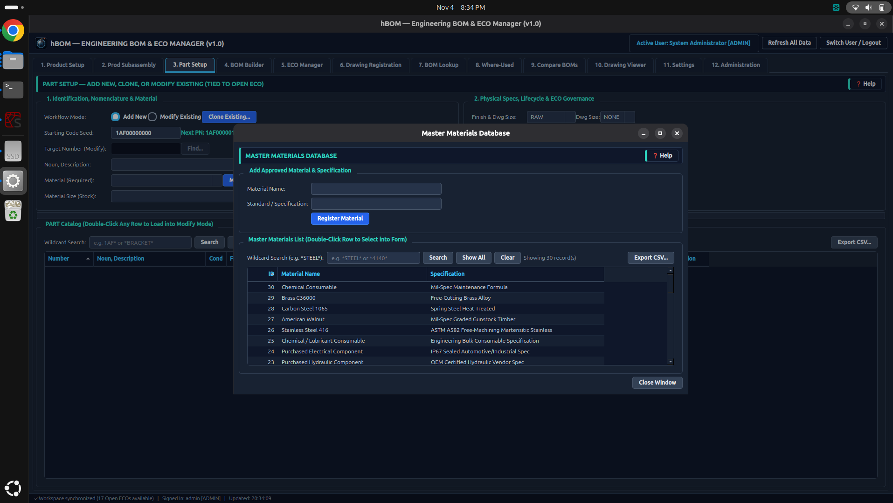
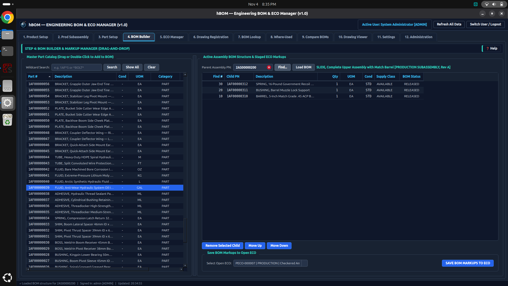
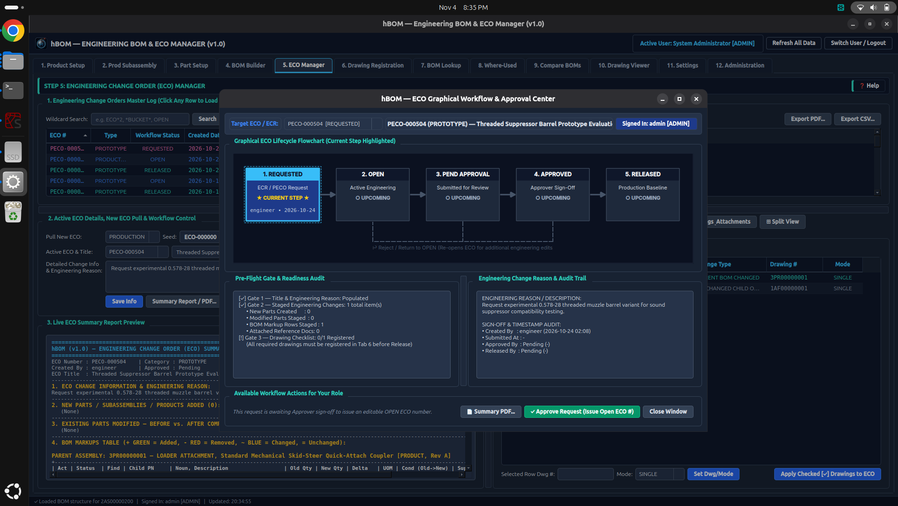
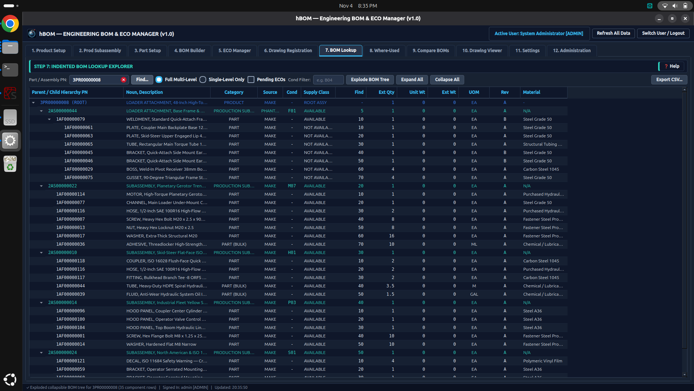
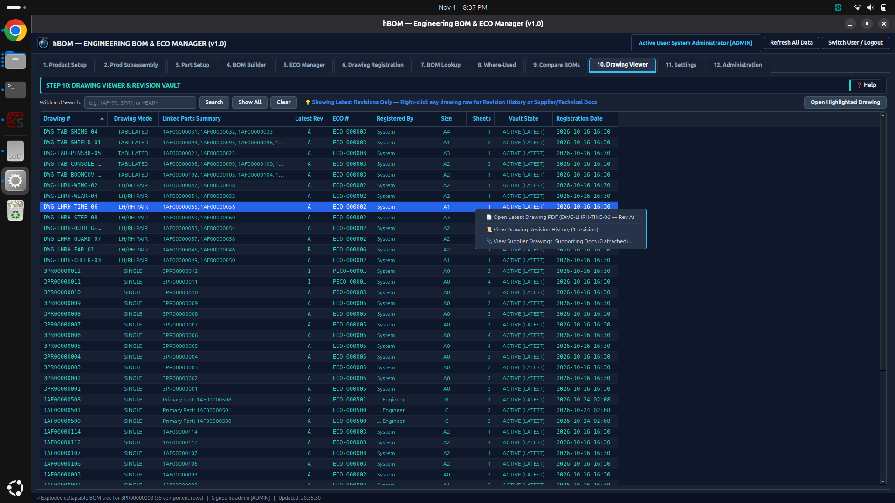

# hBOM (hobby BOM)
An engineering BOM and ECO manager for hobbyist. This program was created (using Google Gemini) so that I had a reliable method for tracking my personal engineering projects. It provides the user with the ability to create parts, build and search BOMs, create ECRs and ECOs, and manage drawings (including revisions and related documents). At the moment everything is built on top of a sqlite database, but I will add support for MariaDB in the future.

To run the program, simply launch the run.py file and use one of the sample user accounts to login. There is viewer, engineer, approver, and admin. All 4 accounts have "demo" as the default password and I have provided BOM and ECO data to test out all of the functions.

Below are a few screenshots to show the current functionality:

